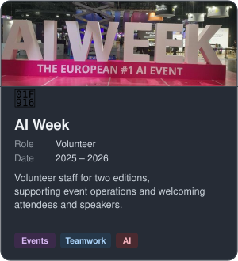
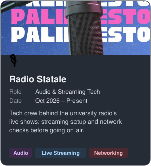
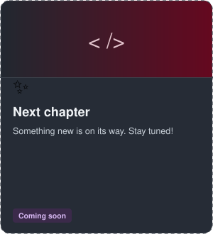

<p align="center">
<a href="https://github.com/MartyMarco"></a>
<br />
</p>

<br />

<p align="center">
<a href="https://www.linkedin.com/in/martina-marcolini-885799410/"></a> <a href="https://github.com/MartyMarco"></a> <a href="mailto:marcolini.martina05@gmail.com?subject=Hi%20from%20GitHub%20%F0%9F%91%8B"></a>
</p>


### 🧬 ABOUT
---

```python
class Me:
    does     = "Computer Science student"
    degree   = "BSc Computer Science @ University of Milan"
    learning = ["Go", "Java", "Python"]
    speaks   = ["Italian", "English"]
    rides    = "Show jumping 🐎"
    motto    = "Always learning"
```
<br />

### 🌱 EXPERIENCE
---

<p align="center">
<a href="https://lnkd.in/p/esNPxRZP"></a>


</p>

<br />

### 🚀 PROJECTS
---

<p align="center"><b>🚧 Work in progress 🚧</b><br /><sub>Still compiling... the first projects are loading. Come back after the next <code>go build</sub></code> 🐹</p>

<br />

### 🧰 STACK
---

<p align="center">

</p>

<br />
<br />
<br />

<p align="center"><b>Working on something cool? I'd love to hear about it.</b></p>

<p align="center">
<a href="mailto:marcolini.martina05@gmail.com?subject=Hi%20from%20GitHub%20%F0%9F%91%8B"></a>
</p>

---

<div align="center">

⭐ Thanks for visiting my profile!

</div>
